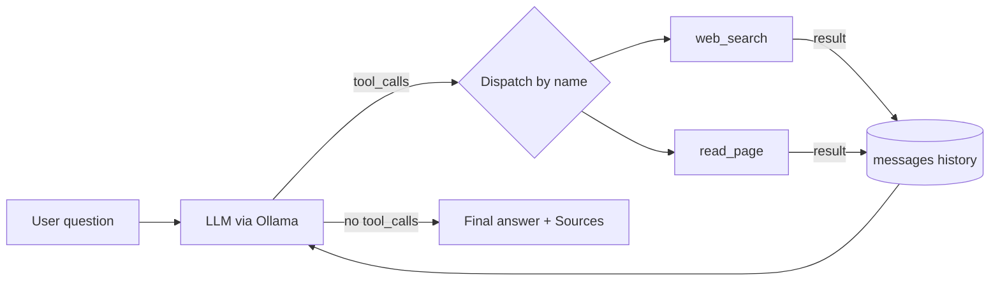

# Search-Agent

A minimal, local tool-calling agent. A small open-weight model running in [Ollama](https://ollama.com) decides when to search the web and when to read a page, and your Python code runs those tools. No cloud LLM and no API keys.

It's a learning project. The goal was to understand every moving part of an agent, so the whole agent is one readable file (`agent.py`, about 170 lines) with no framework.

## What it does

```
You: Has anyone proven the Riemann hypothesis lately?
  [step  1] web_search({'query': 'recent proof of Riemann hypothesis 2026'})
     [1] Riemann Hypothesis Solved? What's Verified in 2026
     [2] Mathematician says he and AI solved Riemann hypothesis - Nature
     [3] AI Proved the Quasi-Riemann Hypothesis. What Happens Now?
     ...

Agent: As of November 2026, claims of proving the Riemann Hypothesis have emerged ...
Sources:
- ...
```

- **`web_search(query)`**: top 5 results (title, URL, snippet) through [`ddgs`](https://pypi.org/project/ddgs/), a metasearch library that needs no API key.
- **`read_page(url)`**: the main text of a page (no menus or ads) through [`trafilatura`](https://trafilatura.readthedocs.io/), capped at 12,000 characters.
- **Agent loop**: the model can chain several tool calls per question, capped at `MAX_STEPS`.
- **Trace**: every tool call, and what it returned, is printed, including failures.

## How it works



1. The question is appended to the `messages` history, after a system prompt that includes today's date.
2. The history and the tool definitions go to the model. Ollama builds each tool's schema from the Python function's name, type hints and docstring.
3. If the model asks for tools, each call is dispatched through the `TOOLS` dictionary, and the result is appended as a `tool` message.
4. This repeats until the model answers without a tool call, or `MAX_STEPS` is reached.

## Requirements

- [Ollama](https://ollama.com), with a tool-calling model pulled: `ollama pull qwen3:8b` (or `qwen3:4b` for lower-end GPUs)
- [uv](https://docs.astral.sh/uv/)
- Python 3.13 (uv installs it if missing)

## Quickstart

```bash
git clone https://github.com/Va-Ns/Search-Agent.git
cd Search-Agent
uv sync            # creates .venv and installs the exact locked versions
uv run agent.py    # type 'quit' or 'exit' to leave
```

## Configuration

These are constants at the top of `agent.py`:

| Constant | Default | Meaning |
|---|---|---|
| `MODEL` | `qwen3:8b` | Any Ollama model that supports tool calling |
| `MAX_STEPS` | `8` | Maximum model calls per question (safety cap) |
| `CONTEXT_TOKENS` | `16384` | Sent as `num_ctx`. Ollama's default was 4096 on the development machine, which is too small for a full page. |
| `MAX_PAGE_CHARS` | `12000` | Page text cap (about 3k tokens), so two pages fit in the context |

A larger context needs more memory. On a 6 GB laptop GPU, `qwen3:8b` ran with 30% of the work on the CPU at 4k context and 46% at 16k, so a larger context means slower answers.

## Known limitations

- Small local models sometimes answer from memory, or blur details from snippets. Check specific numbers and names against the cited sources.
- Search backends time out now and then (handled: the model is told, and can retry).
- `trafilatura` doesn't run JavaScript, so pages built only by JavaScript return no text.
- The conversation history grows without limit within one session.

## Documentation

- [`docs/PROMPT_EVALUATION.md`](docs/PROMPT_EVALUATION.md): how the system prompt was evaluated and improved, with a progress table.
